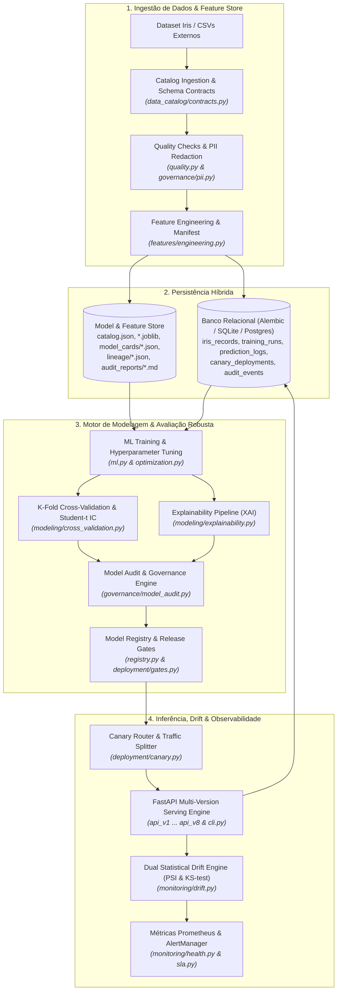
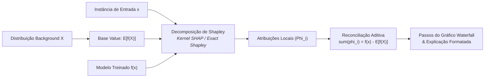
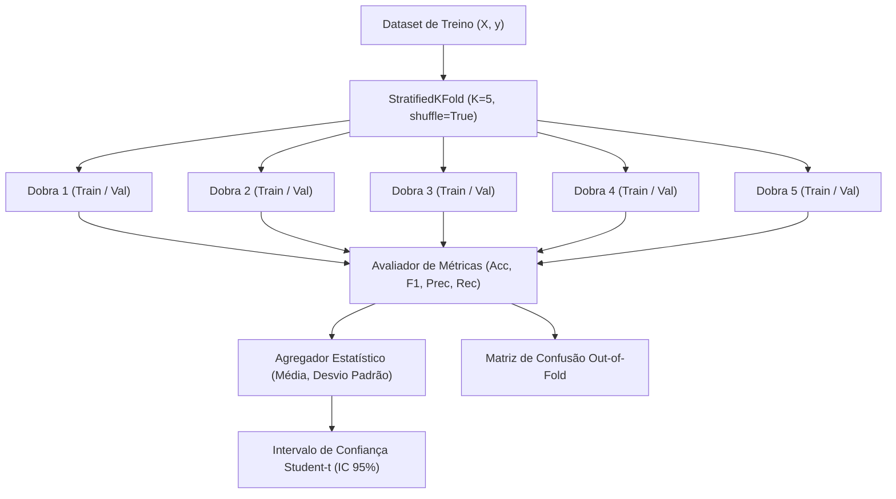
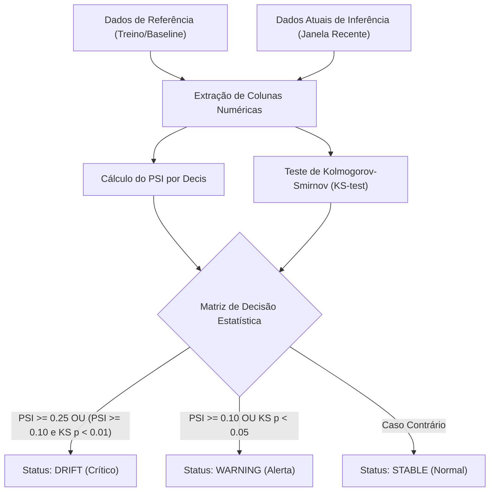
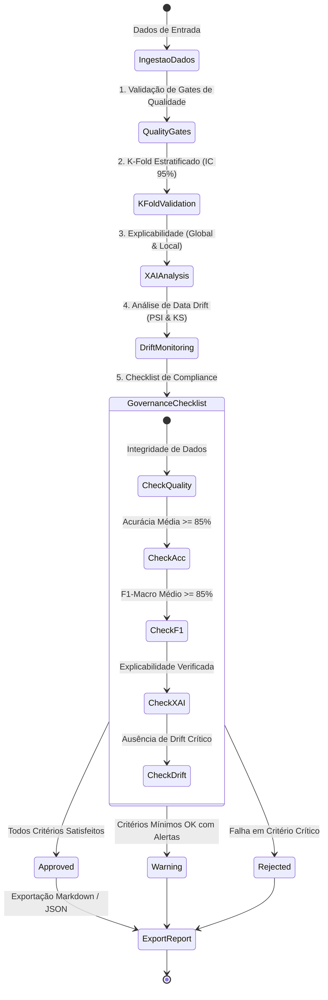

# Arquitetura do Sistema e Governança MLOps (Iris AI Platform)

A plataforma **Iris AI Platform** implementa um ecossistema completo de Engenharia de Machine Learning e MLOps, abrangendo desde a ingestão de dados e feature store até inferência em tempo real, explicabilidade (XAI), detecção estatística de data drift, auditoria automatizada e validação contínua.

---

## 1. Topologia Geral da Plataforma

---

## 2. Pipeline de Explicabilidade de Modelos (XAI)

O módulo de explicabilidade (`app.modeling.explainability`) combina abordagens globais e locais com base matemática rigorosa:

1. **Importância Global Nativa**: extração direta dos coeficientes ponderados em modelos lineares ($\|\beta_j\|$) ou do ganho de impureza Gini/Entropy em árvores e ensembles (`feature_importances_`).
2. **Permutação Pura (Permutation Feature Importance)**: embaralhamento aleatório com semente controlada sobre cada feature de teste/validação, computando a queda média de performance ($\Delta \text{Acc}$) e respectivo desvio padrão ($\sigma$) ao longo de $N$ iterações.
3. **Decomposição Local Aditiva (Kernel SHAP / Shapley Exato)**: para até 10 features, calcula os valores exatos de Shapley sobre todas as $2^M$ coalizões de atributos; para maiores dimensionalidades, utiliza regressão linear ponderada pelo núcleo de Shapley. Garante reconciliação aditiva estrita:
   $$\sum_{j=1}^{M} \phi_j = f(x) - \mathbb{E}[f(X)]$$
4. **Passos de Waterfall e Sumarização**: passos estruturados acumulativos da predição base até a decisão final da instância.

---

## 3. Validação Cruzada K-Fold e Intervalos de Confiança

O motor `app.modeling.cross_validation` fornece validação cruzada $K$-Fold estratificada out-of-fold com estimadores clonados limpos em cada dobra:

- **Estratificação por Classe**: preserva a proporção exata de cada classe em todas as dobras de treino e validação.
- **Rastreamento de Métricas Multi-Classe**: computa Acurácia, Acurácia Balanceada, F1-Score Macro, Precisão Macro e Revocação Macro para cada fold.
- **Intervalos de Confiança (Student-t)**: calcula o intervalo bicaudal a 95% para cada métrica utilizando a distribuição t de Student baseada no desvio amostral e graus de liberdade ($K - 1$).
- **Matriz de Confusão Out-of-Fold**: sintetiza as predições de teste de todas as dobras sem vazamento de dados (*data leakage*).

---

## 4. Detecção Estatística Bicaudal de Data Drift

O subsistema de monitoramento estatístico (`app.monitoring.drift`) implementa uma abordagem híbrida robusta para mitigação de falsos positivos e falsos negativos:

1. **PSI (Population Stability Index)**: divide a distribuição de referência em $B$ decis/percentis e compara com a distribuição atual:
   $$\text{PSI} = \sum_{b=1}^{B} \left( P_b - Q_b \right) \cdot \ln\left( \frac{P_b}{Q_b} \right)$$
   - $\text{PSI} < 0.10$: Distribuição estável.
   - $0.10 \le \text{PSI} < 0.25$: Alerta moderado (*warning*).
   - $\text{PSI} \ge 0.25$: Drift crítico detectado (*drift*).
2. **KS-Test (Kolmogorov-Smirnov bicaudal)**: teste não-paramétrico que avalia a distância suprema entre as funções de distribuição acumulada empíricas (ECDF):
   $$D = \sup_x |F_{\text{ref}}(x) - F_{\text{cur}}(x)|$$
   Calcula o p-valor assintótico exato. Quando $p < \alpha$ (ex.: $\alpha = 0.05$), rejeita a hipótese nula de que ambas as amostras provêm da mesma distribuição contínua.
3. **Classificação Integrada**: combina a sensibilidade do KS-test com a escala de magnitude do PSI para categorizar cada atributo e o dataset geral em `stable`, `warning` ou `drift`.

---

## 5. Auditoria e Governança Técnica de Modelos (Model Audit Report)

O módulo `app.governance.model_audit` consolida as dimensões de confiabilidade de IA em um relatório padronizado e auditável:

---

## 6. Containerização Multi-Stage e Integração Contínua (CI/CD)

- **Multi-Stage Dockerfile**:
  - `builder`: ambiente com compiladores (`build-essential`) e virtualenv isolado em `/opt/venv`, instalando dependências com segurança.
  - `runtime`: imagem final ultra-enxuta baseada em `python:3.13-slim`, sem ferramentas de compilação, executando sob usuário sem privilégios (`app:app`, UID/GID 10001), com `HEALTHCHECK` configurado e diretório persistente `/app/state`.
- **GitHub Actions (`ci.yml`)**:
  - Matriz com Python 3.12 e 3.13.
  - Verificação de código com Ruff (linter e format).
  - Execução total da suíte de testes com Pytest.
  - Teste de integridade de ponta a ponta dos comandos da CLI Typer (`explain-pipeline`, `kfold`, `drift-check`, `audit-export`).
  - Smoke tests com a API em background.
  - Validação da construção da imagem Docker multi-stage via Docker Buildx.
