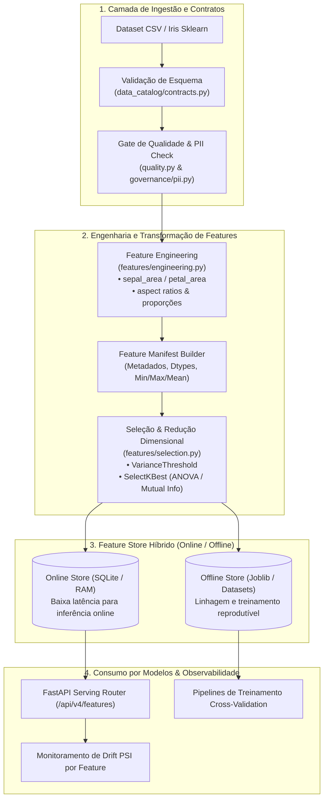
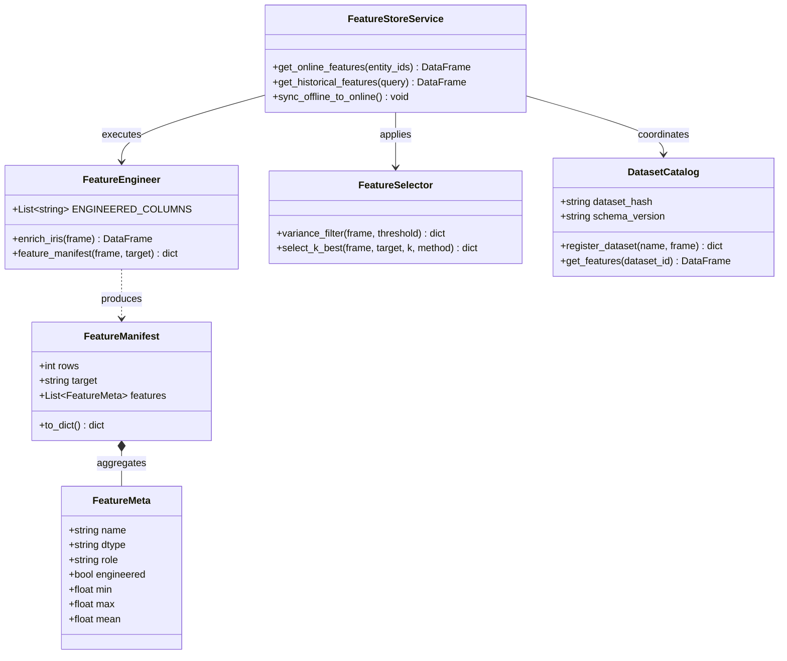
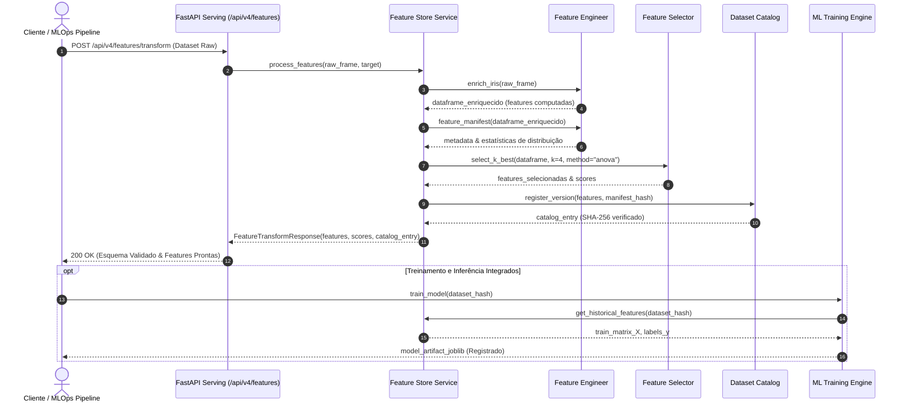

# Iris AI Platform

Plataforma **didática** de Machine Learning e MLOps construída sobre o dataset Iris. O objetivo não é
classificar flores, e sim mostrar, num projeto pequeno e executável, as peças de um ciclo de vida de
modelos: qualidade de dados, treino com validação cruzada, registry versionado com verificação de
integridade, release gate, inferência, explicabilidade por instância, monitoramento de drift e
observabilidade, tudo exposto por uma API FastAPI, uma CLI e um console web.

Versão atual: **8.2.0** (veja o [CHANGELOG](CHANGELOG.md)).

## O que funciona de verdade

| Área | O que faz |
|---|---|
| Explicabilidade Avançada (XAI) | Feature Importance nativa (árvores e linear), Permutation Feature Importance pura com média e desvio padrão, decomposição aditiva local via Kernel SHAP / Shapley Exato com reconciliação estrita e passos de gráfico Waterfall |
| Validação Cruzada K-Fold | K-Fold estratificada out-of-fold com estimadores clonados, métricas multi-classe detalhadas, matriz de confusão agregada e intervalos de confiança bilaterais a 95% via distribuição t de Student |
| Detecção de Data Drift (Dual Engine) | Monitoramento estatístico bicaudal combinando PSI (Population Stability Index) e teste de Kolmogorov-Smirnov (KS-test) com p-valor assintótico, identificando desvios críticos e moderados |
| Auditoria e Governança Técnica | Relatório de auditoria executivo (`ModelAuditReport`) consolidando qualidade, K-Fold, XAI, Drift e checklist com veredito (APPROVED, WARNING, REJECTED), exportável em Markdown com diagrama Mermaid e JSON |
| CLI Avançada | Comandos ricos `explain-pipeline`, `kfold`, `drift-check`, `audit-export`, além de `train`, `compare`, `pipeline`, `predict`, `explain`, `batch-score`, `monitor` e gestão de usuários/catálogo |
| Contêiner Multi-Stage | Dockerfile multi-stage profissional (builder com virtualenv isolado + runtime minimal sem ferramentas de compilação, rodando como usuário não-root `app:app`, com volume persistente e healthcheck) |
| Datasets próprios | Upload de CSV pela API e pela CLI, perfil automático (tipos, nulos, estatísticas, alvo inferido), registro no catálogo com SHA-256, treino, predição, explicação e monitoramento parametrizados pelo dataset |
| Comparação | Vários modelos nas mesmas dobras de uma validação cruzada estratificada, intervalo de confiança t por métrica e da diferença para o melhor, relatório JSON e HTML por execução |
| Canário | Divisão de tráfego por percentual entre a versão estável e a candidata; cada predição registra o ID do canário e o braço, isolando métricas e decisões automáticas de tráfego externo ao experimento |
| Usuários | Papéis `admin`, `operator` e `reader` sobre a API key atual, chaves por usuário guardadas como hash, revogação, autor e papel em cada evento de auditoria |
| Dados | Carrega o Iris do scikit-learn, perfil por coluna, gates de qualidade (colunas, nulos, duplicatas, faixas), catálogo de versões de dataset com SHA-256 e contrato de colunas |
| Treino | 17 modelos (regressão logística, kNN, Naive Bayes, SVM calibrado, árvores, florestas, boosting, XGBoost, MLP, LDA/QDA, ensembles de votação e stacking) + LightGBM e CatBoost com o extra `boosters` |
| Métricas | Acurácia, F1, precisão, recall, validação cruzada, Brier score, latência p95 de uma predição medida no modelo treinado, importância por permutação no conjunto de teste |
| Tuning | XGBoost com Optuna (extra `tuning`); sem Optuna, e para random forest, SVM, regressão logística e MLP, `RandomizedSearchCV`. Pedir tuning de um modelo sem espaço de busca é erro explícito |
| Registry | Versões, estágios (`candidate`, `staging`, `production`, `archived`), checksum SHA-256, assinatura HMAC opcional, lock contra registro concorrente, model card e lineage em JSON |
| Governança | Release gate (acurácia, F1 e latência) obrigatório para promover a `production`, trilha de auditoria no banco, pacote de evidências por versão |
| Inferência | Predição unitária e em lote (uma predição vetorizada por modelo), log de cada predição |
| Monitoramento | Confiança média, latência p50/p95, acurácia a partir de rótulos enviados como feedback, drift PSI contra o dataset de referência, SLOs e nota de saúde com cada desconto identificado; snapshots persistidos e publicados no Prometheus |
| Labs | AutoML tabular por validação cruzada, classificador de texto TF-IDF, previsão de séries com backtest, dados sintéticos, matriz de experimentos, robustez a ruído, varredura de PII, SBOM, busca TF-IDF na documentação, grafo de linhagem |
| Tracing | OpenTelemetry opcional (extra `otel`): spans de FastAPI, SQL, treino, predição, drift e promoção com `model_version` e `dataset_sha`; `trace_id` nos logs JSON e na auditoria; OTLP só com `OTEL_EXPORTER_OTLP_ENDPOINT` |
| Operação | Métricas Prometheus por rota, painel Grafana provisionado, Dockerfile multi-stage, Compose, chart Helm e Terraform que instala o chart |

## ⚡ Quick Start (Início Rápido em 3 Passos)

Requer Python 3.11 ou mais novo:

1. **Clonar e Criar o Ambiente Virtual:**
   ```bash
   git clone https://github.com/vinicius790/IA-em-Python.git && cd IA-em-Python
   python -m venv .venv
   # Windows: .venv\Scripts\activate
   # Linux/macOS: source .venv/bin/activate
   ```

2. **Instalar Dependências de Desenvolvimento:**
   ```bash
   pip install -e ".[dev]"
   ```

3. **Iniciar a API e Acessar:**
   ```bash
   uvicorn app.main:app --reload
   ```
   Abra no seu navegador:
   - **Console Web:** `http://127.0.0.1:8000/console/`
   - **OpenAPI / Swagger UI:** `http://127.0.0.1:8000/docs`

Na primeira execução o banco SQLite (`data/iris.db`) é criado pelas migrações Alembic. Modelos vão para
`models/` e relatórios para `artifacts/` (ambos ignorados pelo git).

Extras opcionais: `pip install -e ".[tuning]"` (Optuna), `".[boosters]"` (LightGBM e CatBoost),
`".[tracking]"` (MLflow), `".[otel]"` (OpenTelemetry; exporta via OTLP só com `OTEL_EXPORTER_OTLP_ENDPOINT` definida), `".[docs]"` (MkDocs).

### Autenticação

Com `ENVIRONMENT=development` (padrão) e `API_KEY` vazia, a API fica aberta para uso local. Com qualquer
outro `ENVIRONMENT` a aplicação **não inicia** sem `API_KEY`. Quando a chave está definida, todas as
rotas `/api` exigem o header `X-API-Key`, exceto `/api/v1/health`, `/api/v1/ready` e `/api/v1/metrics`
(além de `/healthz`, `/readyz`, `/docs` e o console estático). No console, informe a chave no campo do topo.

A `API_KEY` é a chave mestra (papel `admin`). Para dar acesso a outras pessoas sem compartilhá-la, crie
usuários com papel `reader` (leitura e predição), `operator` (treino, upload, canário, promoção) ou `admin`:
`iris-ai user-create ana --role operator` mostra a chave dela uma única vez.

### CLI

```bash
iris-ai models                          # catálogo e quais modelos aceitam tuning
iris-ai train --model xgboost --tune    # treina, avalia e registra
iris-ai pipeline --model random_forest  # qualidade + treino + release gate + relatório HTML
iris-ai predict 5.1 3.5 1.4 0.2         # usa a versão em produção (ou a mais recente)
iris-ai explain 6.7 3.0 5.8 2.2         # valores de Shapley da instância
iris-ai batch-score entrada.csv --output predicoes.csv
iris-ai monitor --model xgboost         # resumo de monitoramento
iris-ai seed | quality | profile | audit | stack | export-openapi

iris-ai explain-pipeline --model logistic_regression --repeats 5 # XAI: Permutação + Feature Importance
iris-ai kfold --model logistic_regression --folds 5             # Validação cruzada com IC Student-t a 95%
iris-ai drift-check --shift 0.8 --alpha 0.05                    # Detecção dual de drift (PSI + KS-test)
iris-ai audit-export --model logistic_regression --format markdown --output artifacts/model_audit.md # Auditoria
iris-ai audit-export --model logistic_regression --format json --output artifacts/model_audit.json

iris-ai dataset-add vinhos.csv --name vinhos   # perfil, validação e registro de um CSV
iris-ai datasets                               # datasets enviados
iris-ai train --model random_forest --dataset vinhos   # registra vinhos.random_forest
iris-ai compare random_forest svm knn --dataset vinhos # IC por modelo + relatório HTML/JSON
iris-ai canary-start vinhos.random_forest 2 --traffic 10
iris-ai canary-status 1 --evaluate             # métricas por braço; promove ou reverte pela regra
iris-ai user-create ana --role operator | users
```

`python -m app.cli <comando>` funciona igual.

### Docker

```bash
cp .env.example .env    # defina API_KEY e GRAFANA_ADMIN_PASSWORD
docker compose up --build -d
```

Sobe a API (porta 8000), o Prometheus (9090) e o Grafana (3000), todos só em `127.0.0.1`.

## Como testar

```bash
pytest                  # nada é gravado dentro do repositório
ruff check . && ruff format --check .
uvicorn app.main:app    # em outro terminal
python scripts/smoke_test.py http://127.0.0.1:8000
```

O CI (`.github/workflows/ci.yml`) roda lint, testes e o smoke test contra a API em execução.

## APIs

As rotas são agrupadas em `/api/v1` a `/api/v8`. São grupos temáticos que foram sendo acrescentados ao
projeto, não versões sucessivas do mesmo contrato:

| Grupo | Conteúdo |
|---|---|
| v1 | saúde, dataset, CRUD de registros Iris, treino síncrono, predição unitária e em lote, registry |
| v2 | status da plataforma, qualidade, manifesto de features, leaderboard, promoção com gate, treino assíncrono e jobs, experimentos, monitoramento, feedback de rótulos, explicação |
| v3 | metadados, perfil do dataset, catálogo de datasets |
| v4 | anomalias, seleção de features, pipeline (dry-run e treino), auditoria, release gate, correlações, manifesto de implantação |
| v5 | fronteira de Pareto (F1 x latência), busca na documentação, intervalo bootstrap |
| v6 | matriz de experimentos, dados sintéticos, robustez, PII, SBOM, pacote de evidências |
| v7 | AutoML, texto, séries temporais, grafo de linhagem |
| v8 | datasets enviados (upload, perfil), predição e explicação com features nomeadas, comparação de modelos, canário, usuários |

Detalhes e exemplos em [docs/api.md](docs/api.md); o guia da 8.1 está em
[docs/datasets-canario-papeis.md](docs/datasets-canario-papeis.md).

## 🏛️ Arquitetura do Feature Store & Fluxo de Dados

O módulo de **Feature Store** (`app/features/` e `app/data_catalog/`) gerencia a extração, transformação, catálogo e versionamento de atributos para treinamento e inferência de baixa latência.

### Fluxo de Dados do Feature Store (Flowchart)



### Diagrama de Classes do Feature Store (ClassDiagram)



### Ciclo de Requisição e Processamento (SequenceDiagram)



## Estrutura

```text
app/
  main.py            aplicação FastAPI, middleware (request id, rate limit, métricas) e routers
  config.py          configuração por variáveis de ambiente
  security.py        autenticação por API key, rate limiter, limite de corpo
  api_v1.py … api_v8.py
  ml.py              catálogo de modelos, treino, tuning, métricas
  registry.py        registry em arquivo com lock, checksum e assinatura
  services.py        regras de negócio (treino, inferência, explicação, monitoramento, promoção)
  explainability.py  importância por permutação e Shapley exato
  monitoring/        drift PSI, SLOs, nota de saúde, Brier, anomalias
  data_catalog/      perfil, contratos, catálogo, ingestão, dados sintéticos
  governance/        auditoria, pacote de evidências, PII
  migrations/        migrações Alembic (únicas responsáveis pelo schema)
  console/           console web estático
  …                  automl, nlp, timeseries, research, pipelines, orchestration, search, knowledge
tests/               testes (pytest)
scripts/smoke_test.py
docs/                documentação (MkDocs); docs/historico guarda os READMEs das versões 4 a 7
infra/               chart Helm e Terraform
ops/                 Prometheus e Grafana
notebooks/           exploração do dataset e laboratório de treino
```

## Limitações conhecidas

- O dataset padrão é o Iris (150 linhas). As métricas servem para demonstrar o ciclo, não para generalizar.
- Datasets enviados: só classificação, CSV UTF-8 até `MAX_REQUEST_BYTES`, e só colunas numéricas viram
  features (colunas de texto aparecem no perfil, mas não entram no treino). Explicação exata até 10 features.
- O intervalo de confiança da comparação usa as dobras da validação cruzada, que não são independentes;
  serve para ordenar modelos, não como teste formal.
- O canário só existe em `/api/v8/predict`; as rotas v1/v2 servem sempre a versão estável.
- Comparação, matriz de experimentos e AutoML treinam dentro da requisição: no máximo 60 treinos de
  validação cruzada (modelos x dobras x repetições) por chamada; acima disso, 422.
- Banco SQLite e registry em arquivo: a aplicação foi feita para **uma** instância. O chart Helm usa uma
  réplica; escalar exige banco externo e armazenamento de artefatos compartilhado.
- Rate limiter e fila de jobs assíncronos vivem na memória do processo; um job em andamento se perde se o
  processo reiniciar.
- Artefatos são arquivos `joblib` (pickle). O checksum detecta corrupção; contra quem pode escrever no
  diretório de modelos, use `ARTIFACT_SIGNING_KEY`.
- Drift é medido contra o próprio Iris e precisa de pelo menos 30 predições.
- A busca de `/api/v5/studio/search` é TF-IDF sobre o README e `docs/`, não busca semântica.
- Docker, Helm e Terraform não foram executados no ambiente em que esta versão foi preparada; veja
  [docs/operacao.md](docs/operacao.md).

## Licença

MIT. Veja [LICENSE](LICENSE).
