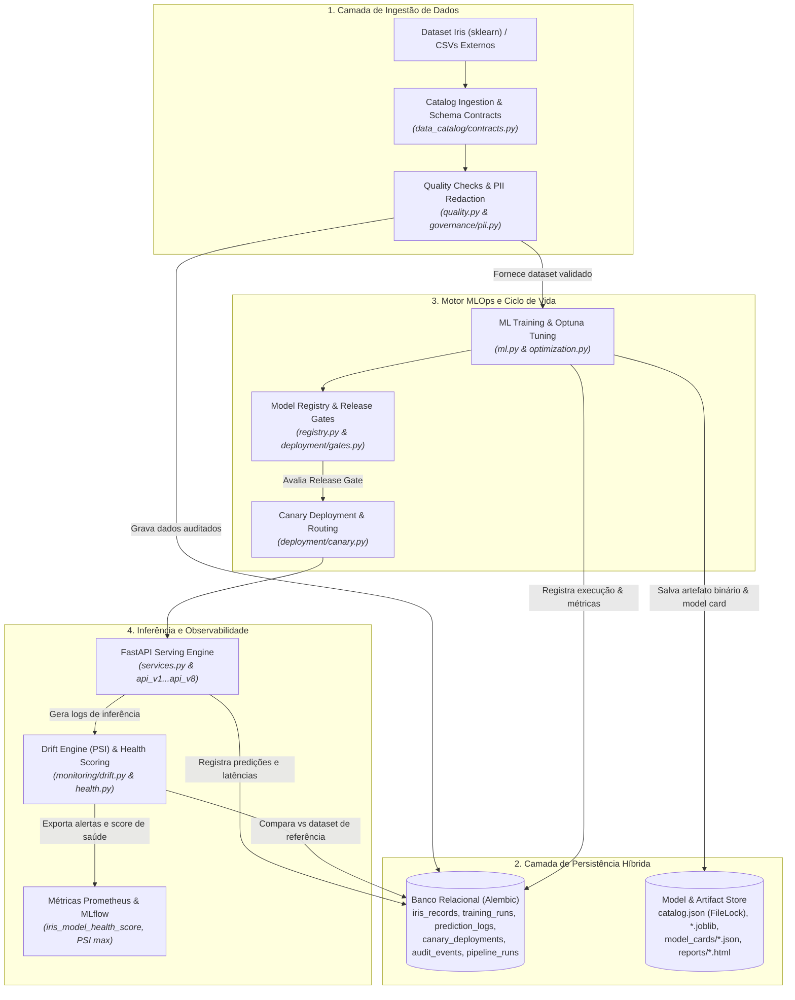
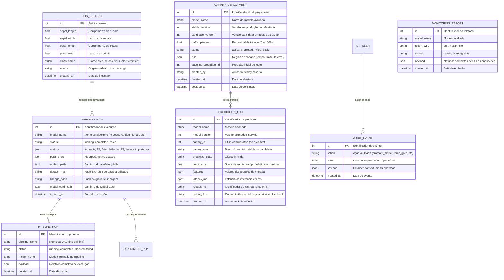
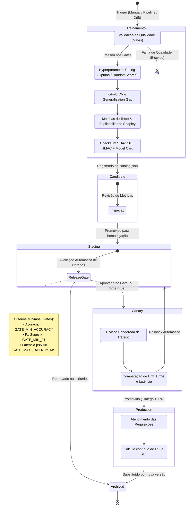
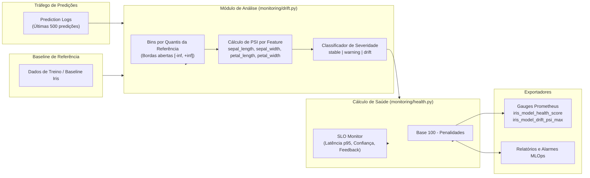
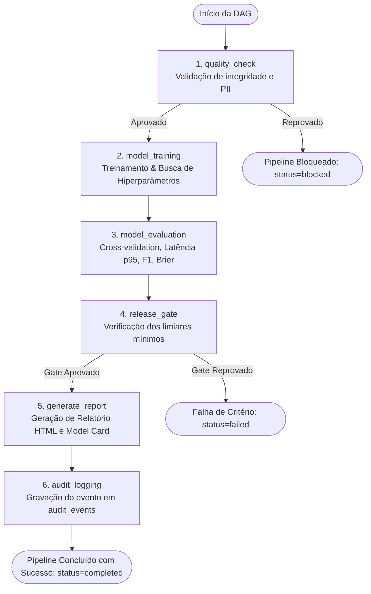
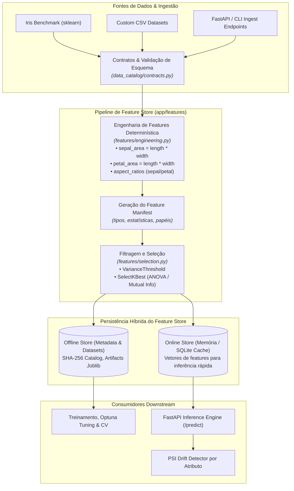
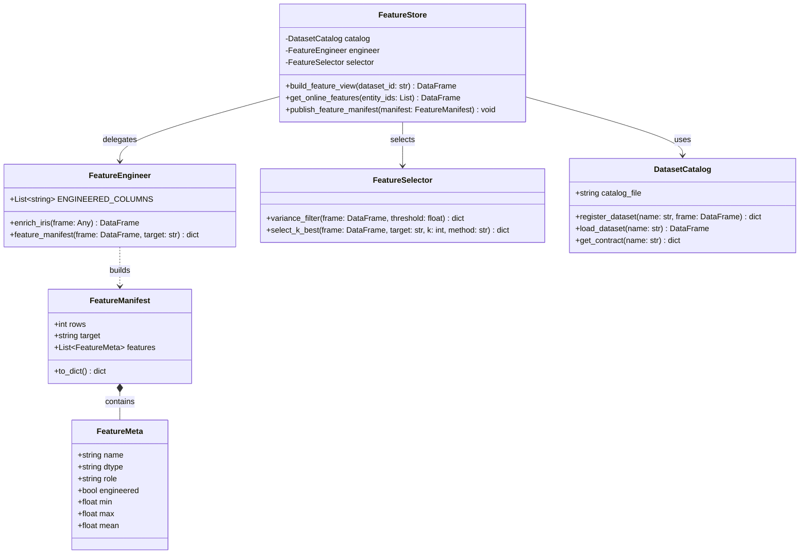
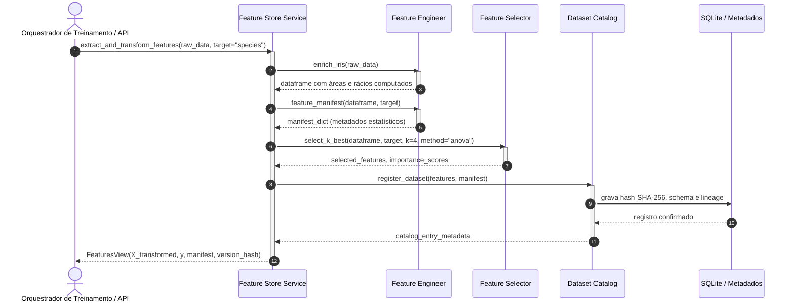

# Arquitetura de Dados e Plataforma MLOps

Este documento detalha a arquitetura de dados, o ciclo de vida completo dos modelos de Machine Learning, a esteira de detecção de *drift*, a orquestração de *pipelines* e a topologia de governança da plataforma **Iris AI Platform** (`IA-em-Python`).

---

## 1. Arquitetura de Dados e Fluxo Geral da Informação

A plataforma opera com uma arquitetura híbrida de persistência:
1. **Metadados e Estado Operacional:** Banco de dados relacional (SQLite em desenvolvimento / PostgreSQL em produção gerenciado via Alembic).
2. **Artefatos e Model Store:** Armazenamento seguro de objetos/arquivos (`MODEL_DIR` e `ARTIFACT_DIR`) com locks de arquivo, verificação de integridade via checksum SHA-256 e assinatura criptográfica HMAC.

---

## 2. Diagrama Entidade-Relacionamento dos Metadados de MLOps

O banco relacional mantém o rastreamento ponto a ponto de cada dataset, treinamento, predição, canário e ação de auditoria:

---

## 3. Ciclo de Vida do Modelo de Machine Learning

O ciclo de vida dos modelos é gerenciado de forma determinística, impedindo que modelos subótimos alcancem o ambiente produtivo.

---

## 4. Arquitetura de Detecção de Drift e Observabilidade

O monitoramento de *drift* calcula o **Population Stability Index (PSI)** comparando a distribuição empírica das últimas 500 inferências contra a distribuição do dataset de referência (Iris baseline).

### 4.1 Formulação do PSI
O cálculo divide a feature em $B = 10$ quantis baseados na referência, com bordas infinitas nas extremidades ($-\infty, +\infty$):

$$PSI = \sum_{b=1}^{B} (A_b - E_b) \times \ln\left(\frac{A_b}{E_b}\right)$$

Onde:
- $E_b$: Proporção de observações no bin $b$ no dataset de referência (esperado).
- $A_b$: Proporção de observações no bin $b$ nas predições recentes (atual).

### 4.2 Matriz de Classificação de Drift e Ações

| Faixa de PSI | Classificação | Impacto no Health Score | Ação do Sistema |
| :--- | :--- | :--- | :--- |
| **$PSI < 0.10$** | `stable` | 0 penalidade | Operação normal contínua. |
| **$0.10 \le PSI < 0.25$** | `warning` | -15 pontos | Alerta preventivo no Prometheus; log de aviso. |
| **$PSI \ge 0.25$** | `drift` | -35 pontos | Alerta crítico; gatilho para re-treinamento automático de pipeline. |

### 4.3 Cálculo do Health Score (0 a 100)
A saúde do modelo em produção parte de **100** e sofre deduções acumuladas registradas em `health.penalties`:
- **-30 pontos:** Falha nos testes de integridade/qualidade dos dados.
- **-15 pontos:** Presença de features em estado `warning`.
- **-35 pontos:** Presença de features com `drift` crítico comprovado.
- **-15 pontos:** Violação de qualquer indicador de nível de serviço (SLO: Latência p95, Confiança média ou Acurácia com feedback).

---

## 5. Orquestração de Pipelines e Execução em DAG

A automação de workflows é estruturada sobre um motor de Grafo Acíclico Dirigido (**DAG**) nativo (`app/orchestration/dag.py`), que valida dependências e executa tarefas em ordem topológica com tratamento de retentativas.

### 5.1 Pipeline Completo de Treinamento e Entrega (`iris-training`)

### 5.2 Garantias de Confiabilidade e Governança
- **Reprodutibilidade:** Toda execução de pipeline armazena o `dataset_hash` e o `lineage_hash`.
- **Rastreabilidade (RBAC e Auditoria):** Cada mudança de estágio no registry requer autenticação com chave de API e papel adequado (`admin` ou `operator`), gravando o autor em `audit_events`.
- **Imutabilidade de Artefatos:** Artefatos serializados possuem lock exclusivo durante escrita e verificação de assinatura HMAC antes de cada carregamento na memória da API.

---

## 6. Arquitetura do Módulo Feature Store & Linhagem de Atributos

O módulo de Feature Store centraliza a definição, cálculo, catalogação e auditoria de variáveis preditivas. Ele garante paridade estrita entre os dados utilizados durante o treinamento em lote (*offline*) e as variáveis servidas em tempo real para inferência de baixa latência (*online*).

### 6.1 Topologia e Fluxo de Dados (Flowchart)

### 6.2 Estrutura de Classes e Contratos (ClassDiagram)

### 6.3 Orquestração e Ciclo de Vida da Feature (SequenceDiagram)

